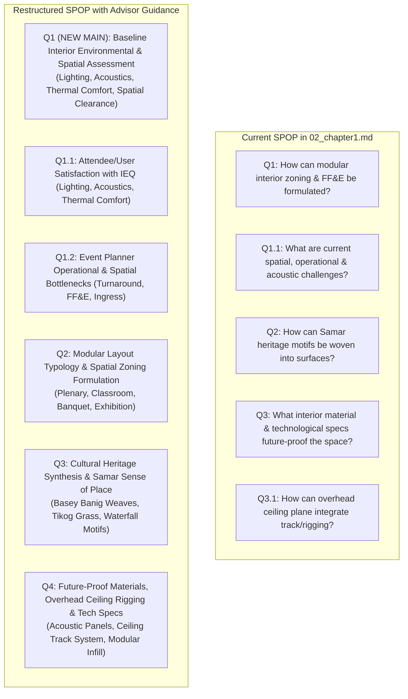

# SPOP & Research Objectives Restructuring Draft: Interior Environmental Quality (IEQ) & Baseline Assessment

**Target Document**: `02_chapter1.md`  
**Reference Locale**: Calbayog City Convention Center (840 sqm Main Hall)  
**Degree Program**: Bachelor of Science in Interior Design  

---

## 1. Thesis Advisor Feedback Analysis & Critical Evaluation

### What the Advisor Suggested:
1. **Create a Dedicated Main Question for the Interior Environment**: Introduce a primary Statement of the Problem (SPOP) question that investigates the **existing interior environmental conditions** (evaluating user/attendee satisfaction in terms of lighting, acoustics, and thermal comfort).
2. **Move the Existing Spatial/Operational Question as a Sub-Question**: Reposition the existing challenge question (*"What are the current spatial, operational, and acoustic challenges..."*) under this new baseline evaluation umbrella.
3. **Primary Objective Alignment**: The overarching objective of this first question is to **empirically measure and evaluate the baseline interior environmental and spatial conditions** of the 840 sqm Main Hall.

---

### Why the Advisor's Feedback is Academically Excellent (Our Evaluation):

| Key Advantage | Why It Strengthens Your Thesis |
| :--- | :--- |
| **1. Logical Research Flow (Assessment $\rightarrow$ Design $\rightarrow$ Specification $\rightarrow$ Validation)** | In architectural and interior design research (Groat & Wang, 2013; Zeisel, 2006), research must start with an **Empirical Baseline Assessment** (*What is wrong with the existing space?*) before jumping into **Design Synthesis** (*How do we design modular layouts?*). Making Question 1 the baseline assessment gives your study a solid scientific foundation. |
| **2. Aligns with Recognized IEQ Frameworks** | In interior design scholarship, evaluating lighting, acoustics, and thermal comfort is known as **Indoor Environmental Quality (IEQ)** assessment (Frontczak & Wargocki, 2011; Leaman & Bordass, 2001). This elevates your thesis from generic decorating to rigorous spatial-environmental performance. |
| **3. Direct Alignment with Your Survey Instrument** | Your survey questionnaire ([37_Survey&Interview.md](file:///C:/Users/Trina/OneDrive/Desktop/thesis%201/New%20Thesis/37_Survey&Interview.md)) already measures lighting adequacy, acoustic echo, temperature comfort, and circulation friction. Creating a dedicated SPOP question directly provides the statistical home for these survey sections. |

---

## 2. Scope Caution for Interior Design (Keeping Within Professional Boundaries)

> [!IMPORTANT]
> **Maintaining the Non-Structural Interior Scope:**
> * **Lighting**: Focus on *architectural lighting layout, ambient illumination, visual comfort, glare reduction, and decorative/task lighting* (not electrical substation engineering).
> * **Acoustics**: Focus on *speech intelligibility, reverberation, and non-structural acoustic wall/ceiling surface finishes* (not heavy acoustic physics engineering).
> * **Thermal Comfort**: Focus on *spatial occupant density, interior air distribution/cross-draft zones, and shading/glare at openings* (clarify that HVAC mechanical engineering and ductwork sizing are non-structural conceptual interfaces, per your Scope & Limitations).

---

## 3. Proposed SPOP & Research Objectives Restructuring

### Comparison: Current Structure vs. Proposed Advisor Structure

---

## 4. Polished Phrasing Options for the SPOP & Objectives

### Option A: The "Indoor Environmental Quality (IEQ) & Spatial Performance" Approach (Recommended)
*This is the most academically rigorous phrasing, utilizing formal environmental design terminology.*

#### Statement of the Problem:
1. **What is the current baseline condition of the Calbayog City Convention Center's Main Hall in terms of indoor environmental quality (IEQ) and spatial operational efficiency?**
   * **1.1.** What is the level of attendee and stakeholder satisfaction regarding the existing interior environment in terms of:
     * *1.1.1. Lighting (ambient illuminance, visual clarity, and glare control);*
     * *1.1.2. Acoustics (speech intelligibility, reverberation, and sound dispersion); and*
     * *1.1.3. Thermal comfort (air movement distribution and perceived temperature satisfaction)?*
   * **1.2.** What are the existing spatial, operational, and layout turnaround challenges encountered by event planners and venue operators within the 840 square meter interior envelope?
2. **How can modular interior zoning, reconfigurable FF&E, and standardized layout typologies (Plenary, Classroom, Banquet, Exhibition) be formulated to maximize spatial capacity, configuration speed, and universal accessibility compliance (BP 344/ADA)?**
3. **In what ways can localized Samar heritage motifs and cultural elements be woven into interior surface treatments to cultivate a distinct sense of place without restricting space versatility?**
4. **What interior material, acoustic overlay, and overhead ceiling track specifications can future-proof the facility for multi-scale event adaptability?**

#### Corresponding Research Objectives:
1. **To evaluate the baseline interior environmental quality (IEQ) and spatial operational conditions of the Calbayog City Convention Center's Main Hall.**
   * **1.1.** Measure attendee and stakeholder satisfaction with the existing interior lighting, acoustic performance, and thermal comfort.
   * **1.2.** Identify the primary spatial bottlenecks, circulation constraints, and setup turnaround delays experienced during live venue operations.
2. **To formulate standardized modular layout typologies (Plenary, Classroom, Banquet, Exhibition) and flexible FF&E arrangements that maximize spatial efficiency and accelerate turnaround speed.**
3. **To synthesize culturally-responsive interior surface treatments—abstracting Basey *banig* weaving patterns, *tikog* grass textures, and Calbayog waterfall motifs—to establish a localized civic identity.**
4. **To propose future-proof interior material specifications, acoustic wall assemblies, and a non-structural overhead ceiling track/rigging interface to support multi-event adaptability.**

---

### Option B: The "User Satisfaction & Existing Interior Environment" Approach (Advisor Direct Synthesis)
*This stays closest to your advisor's exact wording while polishing grammar and academic tone.*

#### Statement of the Problem:
1. **How satisfied are the users and event stakeholders with the existing interior environment and spatial performance of the Calbayog City Convention Center?**
   * **1.1.** What is the level of user satisfaction with the interior environment in terms of:
     * *1.1.1. Lighting and visual comfort;*
     * *1.1.2. Acoustic clarity and noise control; and*
     * *1.1.3. Thermal comfort and indoor ventilation?*
   * **1.2.** What are the existing spatial layout, circulation, and operational turnaround bottlenecks within the 840 sqm Main Hall?
2. **How can modular spatial layouts (Plenary, Classroom, Banquet, Exhibition) and flexible FF&E typologies be developed to optimize configuration speed and BP 344 accessibility?**
3. **How can traditional Samar Basey banig weaving and Calbayog eco-tourism motifs be abstracted into interior finishes to create place attachment?**
4. **What future-proof material, acoustic, and overhead utility specifications are required to maintain long-term functional adaptability?**

---

### Option C: The 4-Pillar Sequential SPOP (Assessment $\rightarrow$ Modularity $\rightarrow$ Culture $\rightarrow$ Future-Proofing)
*Separates the study into 4 clean, parallel research pillars.*

* **Pillar 1 (Baseline Assessment)**: Evaluation of Existing Interior Environment (Lighting, Acoustics, Thermal Comfort, and Operational Logistics).
* **Pillar 2 (Spatial Modularity)**: Formulation of Modular Layout Manual & FF&E Typologies (Plenary, Banquet, Classroom, Exhibition).
* **Pillar 3 (Cultural Identity)**: Integration of Samar Weaving & Calbayog Waterfall Heritage.
* **Pillar 4 (Technical Future-Proofing)**: Material Specifications & Overhead Ceiling Rigging Interface.

---

## 5. Summary of Questions to Clarify With You Before Making Changes

Before applying changes to `02_chapter1.md`, please review and confirm:
1. **Terminology Preference**: Do you prefer **Option A** (*"Indoor Environmental Quality (IEQ) & Spatial Performance"*) or **Option B** (*"User Satisfaction & Existing Interior Environment"*)?
2. **Sub-Question Breakdown**: Do you like having **1.1** focus on user satisfaction (lighting, acoustics, thermal comfort) and **1.2** focus on event planner operational bottlenecks (turnaround time, loading, furniture layout)?
3. **Scope Confirmation**: Confirming that thermal comfort will be evaluated as *perceived occupant comfort / temperature satisfaction / natural air flow at interior openings* without delving into mechanical HVAC engineering.
