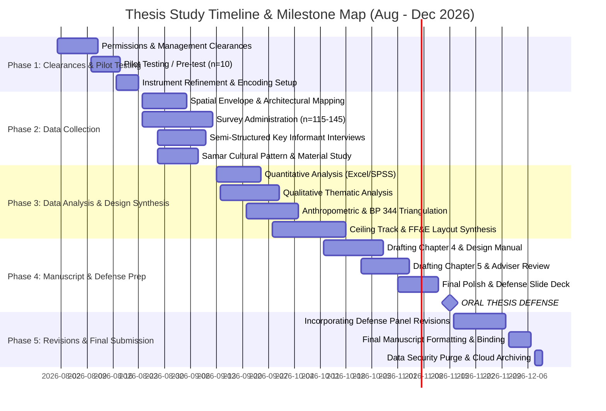

 Research Project Timeline & Gantt Chart

**Study Title:** Non-Structural Interior Design Framework & Reconfigurable FF&E Typologies for the 840 sqm Interior Envelope (711 sqm Main Hall & 129 sqm Foyer) of the Calbayog City Convention Center  
**Target Duration:** August 2026 – December 2026  
**Key Target Milestone:** Oral Thesis Defense (Mid-November 2026)  

---

## 1. Visual Timeline (Mermaid Gantt Chart)

---

## 2. Phase-by-Phase Activity Breakdown

### Phase 1: Pre-Data Collection & Instrument Validation
**Timeframe:** August 1 – August 23, 2026  
**Primary Alignment:** [33_Instruments.md](file:///C:/Users/Trina/OneDrive/Desktop/thesis%201/New%20Thesis/33_Instruments.md), [34_Data Collection.md](file:///C:/Users/Trina/OneDrive/Desktop/thesis%201/New%20Thesis/34_Data%20Collection.md)

* **Ethical Clearances & Management Approvals (Aug 1 – Aug 12):** Secure official written authorization from Calbayog City Convention Center management and municipal authorities. Prepare informed consent documentation.
* **Pilot Pre-Testing (Aug 10 – Aug 18):** Administer researcher-developed survey instrument to a pre-test sample of 10 respondents (event coordinators and attendees excluded from final sample) to measure item readability and scale reliability (Cronbach’s alpha).
* **Instrument Polish & Setup (Aug 17 – Aug 23):** Revise questionnaire item phrasing based on pilot feedback. Prepare digital survey forms (Google Forms) and printed questionnaire packages.

---

### Phase 2: Field Data Collection & Spatial Mapping
**Timeframe:** Late August – Early September 2026 (August 24 – September 12, 2026)  
**Primary Alignment:** [30_Research Design.md](file:///C:/Users/Trina/OneDrive/Desktop/thesis%201/New%20Thesis/30_Research%20Design.md), [31_Research environment.md](file:///C:/Users/Trina/OneDrive/Desktop/thesis%201/New%20Thesis/31_Research%20environment.md), [32_Respondents.md](file:///C:/Users/Trina/OneDrive/Desktop/thesis%201/New%20Thesis/32_Respondents.md), [34_Data Collection.md](file:///C:/Users/Trina/OneDrive/Desktop/thesis%201/New%20Thesis/34_Data%20Collection.md)

* **Architectural Envelope & On-Site Observation (Aug 24 – Sept 5):** Conduct field observations during both active event setups and non-event periods in the 840 sqm interior envelope (711 sqm Main Hall & 129 sqm Foyer). Document baseline egress capacities, circulation bottlenecks, and structural entry points.
* **Structured Survey Distribution (Aug 24 – Sept 12):** Administer structured surveys to 115–145 total respondents, comprising:
  * Specialized Expert Sample (15–25 event planners/operators)
  * Representative Public Sample (100–120 venue attendees)
* **Qualitative Key Informant Interviews (Aug 28 – Sept 10):** Conduct 20–30 minute semi-structured interviews (in-person or digital) with event operators and facility managers. Audio-record with consent and transcribe verbatim.
* **Cultural Material & Pattern Vocabulary Documentation (Aug 28 – Sept 8):** Document traditional Samar *banig* (mat) weaving motifs, *tikog* grass textures, regional Waray geometric symbols, and Calbayog waterfall imagery for qualitative pattern abstraction.

---

### Phase 3: Data Analysis & Design Framework Synthesis
**Timeframe:** Mid-September – Mid-October 2026 (September 13 – October 18, 2026)  
**Primary Alignment:** [35_Data Analysis.md](file:///C:/Users/Trina/OneDrive/Desktop/thesis%201/New%20Thesis/35_Data%20Analysis.md), [30_Research Design.md](file:///C:/Users/Trina/OneDrive/Desktop/thesis%201/New%20Thesis/30_Research%20Design.md)

* **Quantitative Data Analysis (Sept 13 – Sept 25):** Encode and clean survey datasets in MS Excel/SPSS. Compute descriptive statistics (frequencies, percentages, weighted means, standard deviations) for spatial challenges, turnaround times, and ceiling track utility.
* **Qualitative Thematic Analysis (Sept 14 – Sept 30):** Execute Braun & Clarke’s 6-phase thematic analysis (familiarization, initial coding, theme search, theme review, theme definition, narrative report) on interview transcripts.
* **Methodological Triangulation (Sept 21 – Oct 5):** Cross-reference survey/interview empirical trends with anthropometric clearance standards (Panero & Zelnik; Neufert) and universal accessibility mandates (BP 344; ADA Standards 2010).
* **Design Synthesis & Framework Formulation (Sept 28 – Oct 18):**
  * Formulate overhead non-structural ceiling grid & track rigging interface parameters.
  * Develop standardized menu of modular, reconfigurable FF&E layout typologies (Theater, Classroom, Banquet, Exhibition).
  * Synthesize Samar heritage surface pattern matrix for non-structural wall/floor treatments.

---

### Phase 4: Manuscript Finalization & Defense Preparation
**Timeframe:** Mid-October – Mid-November 2026 (October 12 – November 15, 2026)  
**Primary Alignment:** [00_introduction.md](file:///C:/Users/Trina/OneDrive/Desktop/thesis%201/New%20Thesis/00_introduction.md), [01_rationale.md](file:///C:/Users/Trina/OneDrive/Desktop/thesis%201/New%20Thesis/01_rationale.md), [02_chapter1.md](file:///C:/Users/Trina/OneDrive/Desktop/thesis%201/New%20Thesis/02_chapter1.md)

* **Drafting Chapter 4 (Results & Discussion) & Design Manual (Oct 12 – Oct 28):** Synthesize empirical findings, statistical tables, thematic narratives, layout matrices, and spatial clearance diagrams into Chapter 4.
* **Drafting Chapter 5 & Adviser Review (Oct 22 – Nov 4):** Write summary of findings, conclusions, and operational recommendations. Submit complete thesis draft to thesis advisor for feedback and approval.
* **Defense Presentation Polish (Nov 1 – Nov 12):** Prepare oral defense presentation slide deck, graphical abstracts, FF&E layout sheets, and visual aid exhibits.
* **ORAL THESIS DEFENSE (Target: November 15, 2026):** Present study to the Thesis Panel of Examiners.

---

### Phase 5: Post-Defense Revisions & Final Submission
**Timeframe:** Late November – Early December 2026 (November 16 – December 10, 2026)  

* **Incorporating Defense Panel Revisions (Nov 16 – Nov 30):** Address all panel comments, editorial suggestions, and minor manuscript/design framework updates.
* **Final Manuscript Formatting & Binding (Dec 1 – Dec 7):** Perform final proofreading, institutional layout formatting, advisor/panel signature page approvals, and hardbound printing.
* **Data Privacy Archiving & Purge (Dec 8 – Dec 10):** Securely archive anonymized research records and purge sensitive audio recordings in accordance with RA 10173 (Data Privacy Act of 2012).

---

## 3. Core Milestones Summary Table

| Milestone Description | Target Start Date | Target End Date | Associated Deliverable / Output |
| :--- | :--- | :--- | :--- |
| **hi gemini, in @REC\00REC_Timeline.md can you help me create a timeline for my study, for context, I plan to do my data collection on late
  august to early september, then data collection, data analysis and whatever else you think might follow for my study, make it in a gantt
  chart format if you can, the goal is to be able to defend my study by around november and then the finished study will follow, for
  context you can check @00_introduction.md @01_rationale.md @02_chapter1.md @20_RRL.md @30_Research Design.md @31_Research environment.md
  @31_Research environment.md @32_Respondents.md @34_Data Collection.md @33_Instruments.md @35_Data Analysis.md , dont forget to ask me
  questions before changing anything** | August 1, 2026 | August 23, 2026 | Approved Permit & Reliable Questionnaire |
| **Data Collection Window** | August 24, 2026 | September 12, 2026 | Surveys (n=115-145), Transcripts & Spatial Logs |
| **Data Analysis & Triangulation** | September 13, 2026 | October 5, 2026 | SPSS/Excel Outputs & Qualitative Theme Matrix |
| **Design Framework & Typologies** | September 28, 2026 | October 18, 2026 | Overhead Grid Specs & FF&E Layout Typologies |
| **Full Manuscript Submission** | October 22, 2026 | November 4, 2026 | Adviser-Approved Thesis Manuscript Draft |
| **ORAL THESIS DEFENSE** | **November 15, 2026** | **November 15, 2026** | **Thesis Defense Presentation & Panel Approval** |
| **Final Hardbound & Archiving** | December 1, 2026 | December 10, 2026 | Signed Thesis Copies & RA 10173 Data Purge |
