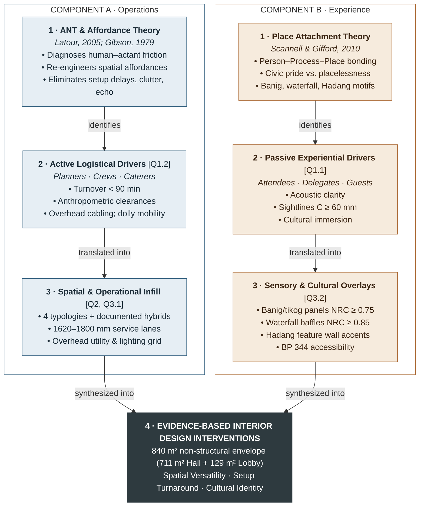

# Conceptual Framework — Diagram Guide

Basis for drawing **Figure: Conceptual Framework** from the table in `21_theoretical_conceptual.md` §2. Every box text below is lifted from that table; shortened only for space. Follow top to bottom.

---

## 1. Diagram Type & Reading Order

**Two-lane, four-tier converging flow.** Read top → bottom.

- **Left lane** = Component A: Socio-Technical Operations & Infill (the *function* side)
- **Right lane** = Component B: Cultural Sensory Placemaking & Experience (the *experience* side)
- Each lane runs through Stages 1 → 2 → 3, then **both lanes merge** into one Stage 4 outcome box.

Core message the drawing must carry: *two theories → two stakeholder groups → two intervention sets → one unified design outcome.*

---

## 2. Layout Skeleton

```
            ┌──────────────────────────────────────────────────────────────────────┐
            │  OPTIONAL SCOPE FRAME (dashed): 840 m² non-structural interior envelope │
            │                                                                      │
 STAGE      │   COMPONENT A                              COMPONENT B               │
 RAIL       │   Socio-Technical Operations & Infill      Cultural Sensory          │
            │                                            Placemaking & Experience  │
            │  ┌───────────────────────┐            ┌───────────────────────┐      │
  1         │  │ A1  ANT + Affordance  │◄┈┈┈┈┈┈┈┈┈┈►│ B1  Place Attachment  │      │
 Theoretical│  │     Theory            │complement- │     Theory (PPP)      │      │
 Anchors    │  └───────────┬───────────┘ ary        └───────────┬───────────┘      │
            │              ▼                                    ▼                  │
  2         │  ┌───────────────────────┐            ┌───────────────────────┐      │
 Stakeholder│  │ A2  Active Logistical │            │ B2  Passive           │      │
 Drivers    │  │     Drivers [Q1.2]    │            │     Experiential      │      │
            │  └───────────┬───────────┘            │     Drivers [Q1.1]    │      │
            │              ▼                        └───────────┬───────────┘      │
  3         │  ┌───────────────────────┐            ┌───────────▼───────────┐      │
 Evidence-  │  │ A3  Spatial &         │◄┈┈┈┈┈┈┈┈┈┈►│ B3  Sensory &         │      │
 Based      │  │     Operational Infill│ acoustic   │     Cultural Overlays │      │
 Interven-  │  │     [Q2, Q3.1]        │ infill     │     [Q3.2]            │      │
 tions      │  └───────────┬───────────┘ bridge     └───────────┬───────────┘      │
            │              └──────────────┐   ┌─────────────────┘                  │
            │                             ▼   ▼                                    │
  4         │  ┌───────────────────────────────────────────────────────────────┐   │
 Unified    │  │ OUT  EVIDENCE-BASED INTERIOR DESIGN INTERVENTIONS             │   │
 Outcome    │  │      (spans both lanes)                                       │   │
            │  └───────────────────────────────────────────────────────────────┘   │
            └──────────────────────────────────────────────────────────────────────┘
```

Proportions (portrait, full-width manuscript figure ≈ 16 cm wide):

| Element | Width share |
| :--- | :--- |
| Stage rail (left labels) | ~12% |
| Lane A boxes | ~38% |
| Gap between lanes (holds dashed bridges) | ~12% |
| Lane B boxes | ~38% |

- All Stage 1–3 boxes in one row share the **same height** (match the taller one, usually B3 with 4 bullets).
- Stage 4 box spans **both lanes edge to edge**.

---

## 3. Box Contents (copy these)

Format per box: **Title** (bold) → sub-title / citation (italic) → bullets (max 3–4) → optional SOP chip.

### Lane headers (above Stage 1)

| Lane | Header text |
| :--- | :--- |
| A | **COMPONENT A** — Socio-Technical Operations & Infill |
| B | **COMPONENT B** — Cultural Sensory Placemaking & Experience |

### Stage 1 — Theoretical Anchors

**A1 · Actor-Network Theory & Affordance Theory**
*(Latour, 2005; Gibson, 1979)*
- Diagnoses human–actant operational friction
- Re-engineers spatial action affordances
- Eliminates setup delays, clutter, and acoustic echo

> Optional mini-graphic inside A1: two small icons joined by a double arrow — **Human Actors ⇄ Non-Human Actants** (from the Pillar 1 table, §1).

**B1 · Theory of Place Attachment**
*(Scannell & Gifford, 2010)*
- Person–Process–Place (PPP) bonding mechanism
- Fosters civic pride; eliminates generic placelessness
- Translates Basey *banig* weaving, waterfall, and Hadang motifs

> Optional mini-graphic inside B1: small triangle of three circles — **Person · Process · Place**.

### Stage 2 — Stakeholder Drivers

**A2 · Active Logistical Drivers**
*Planners · Crews · Caterers* — chip: `SOP Q1.2`
- Rapid room turnover (< 90 min)
- Pre-calculated anthropometric clearances
- Safe overhead cable routing; cart/dolly mobility

**B2 · Passive Experiential Drivers**
*Attendees · Delegates · Guests* — chip: `SOP Q1.1`
- Acoustic clarity and speech intelligibility
- Unobstructed stage sightlines (C ≥ 60 mm)
- Cultural immersion in Samar-Calbayog heritage

### Stage 3 — Evidence-Based Interventions

**A3 · Spatial & Operational Infill Interventions** — chips: `SOP Q2` `SOP Q3.1`
- 4 primary typologies (Plenary, Classroom, Banquet, Exhibition) + documented hybrids
- Anthropometric clearance rules (1620–1800 mm service lanes)
- Overhead ceiling utility and lighting track grid

**B3 · Sensory & Cultural Placemaking Overlays** — chip: `SOP Q3.2`
- Basey *banig* / *tikog* acoustic panels (NRC ≥ 0.75)
- Kinetic waterfall suspended baffles (NRC ≥ 0.85)
- Hadang Festival dynamic feature wall accents
- BP 344 universal accessibility & PWD integration

### Stage 4 — Unified Design Outcome (spans both lanes)

**EVIDENCE-BASED INTERIOR DESIGN INTERVENTIONS**
*for the Calbayog Cultural Convention Center*

Comprehensive non-structural interior scheme for the **840 m²** interior envelope (**711 m² Main Hall + 129 m² Lobby**), optimizing:

`Spatial Versatility` · `Setup Turnaround` · `Samar-Calbayog Cultural Identity`

> Tip: draw the three outcome targets as three equal pills inside the box. Left pill sits under Lane A, right pill under Lane B, middle pill centered — shows the merge visually.

### SOP chip key

SOP chips come from the Synthesis paragraphs in `21_theoretical_conceptual.md` (not the table itself). Keep them if your adviser wants SOP traceability; drop them for a cleaner figure.

| Chip | Placed on | SOP meaning |
| :--- | :--- | :--- |
| Q1.1 | B2 | Attendee experiential deficits |
| Q1.2 | A2 | Planner / crew logistical challenges |
| Q2 | A3 | Modular layouts, 50–500 occupants |
| Q3.1 | A3 | Overhead track-and-rigging interface |
| Q3.2 | B3 | Cultural motifs in interior finishes |

---

## 4. Connectors

| # | From → To | Line style | Label (optional, small italic) |
| :--- | :--- | :--- | :--- |
| 1 | A1 → A2 | Solid arrow, lane A color | *identifies* |
| 2 | A2 → A3 | Solid arrow, lane A color | *translated into* |
| 3 | B1 → B2 | Solid arrow, lane B color | *identifies* |
| 4 | B2 → B3 | Solid arrow, lane B color | *translated into* |
| 5 | A3 → OUT | Solid arrow, converging (Y-merge) | *synthesized into* |
| 6 | B3 → OUT | Solid arrow, converging (Y-merge) | *synthesized into* |
| 7 | A1 ⇠⇢ B1 | Dashed, double-headed, neutral gray | *complementary paradigms* |
| 8 | A3 ⇠⇢ B3 | Dashed, double-headed, neutral gray | *acoustic infill serves both* |

Why connector 8 exists: A1 promises to eliminate acoustic echo, but the acoustic fix (banig panels, waterfall baffles) sits in B3. The Synthesis says acoustic remediation "doubles as an instrument of local heritage preservation." The dashed bridge shows that one intervention serves both lanes. Without it, a panelist may ask why the echo problem in Lane A gets solved in Lane B.

Rules:
- Solid = sequential flow (stage to stage). Dashed = relationship (lane to lane). Don't mix.
- Arrows never cross boxes. Route connectors 5–6 down and inward to the top edge of OUT.

---

## 5. Visual Coding

| Element | Suggestion |
| :--- | :--- |
| Lane A color | Cool slate blue — stroke `#2F5D7C`, fill `#E6EEF4` |
| Lane B color | Warm banig tan — stroke `#A8652F`, fill `#F6EBDD` |
| Outcome box | Dark neutral fill `#2E3A3F`, white text (heaviest visual weight) |
| Dashed bridges | Gray `#8A8A8A`, 1 pt, 4-2 dash |
| Stage rail | Number large (18–20 pt), stage name small caps (8–9 pt), gray |
| SOP chips | Small rounded pill, white fill, lane-color outline, 7–8 pt |

Typography ladder (at 16 cm figure width):

| Level | Size | Weight |
| :--- | :--- | :--- |
| Lane header | 11–12 pt | Bold, caps |
| Box title | 9.5–10 pt | Bold |
| Citation / stakeholder line | 8 pt | Italic |
| Bullets | 8–8.5 pt | Regular |
| Connector labels | 7 pt | Italic, gray |

- Optional banig texture: a faint woven pattern (≤ 8% opacity) on Lane B box fills only. It ties the figure to the cultural thesis. Keep it faint so it doesn't hurt legibility.
- Must still read in grayscale print: lanes differ by fill lightness as well as hue. Outcome box is darkest.

---

## 6. Optional Layers

**a) Scope frame.** Draw a dashed outer rectangle around the whole diagram. Put a label in its top-right corner:
`Non-structural interior envelope · 840 m² · RA 10350 · PD 1096 — columns, façades, roof trusses unaltered`
Source: the scope note in §1 and the Synthesis, paragraph 1.

**b) IPO strip.** Only add this if your adviser expects an Input–Process–Output paradigm. Put a thin vertical strip on the far right:

| Stages | IPO label |
| :--- | :--- |
| 1–2 (Anchors + Drivers) | INPUT |
| 3 (Interventions) | PROCESS |
| 4 (Unified Outcome) | OUTPUT |

---

## 7. Mermaid Draft (quick preview)

Paste into <https://mermaid.live> for a rough draft to trace over. Mermaid can't do the exact lane widths or chips, so use it to check the structure and then redraw in Canva / Illustrator / draw.io.



---

## 8. Pre-Submit Checklist

- [ ] Numbers match the manuscript: 840 = 711 + 129 m² · < 90 min turnover · 1620–1800 mm lanes · C ≥ 60 mm · NRC ≥ 0.75 panels · NRC ≥ 0.85 baffles
- [ ] Citations in A1/B1 match the reference list (Latour 2005; Gibson 1979; Scannell & Gifford 2010)
- [ ] Every box has exactly one arrow in from the stage above (except Stage 1)
- [ ] Stage 4 box spans both lanes; it is the only box with dark fill
- [ ] Legible in grayscale print at final size
- [ ] Figure number and caption placed per your college format (APA 7 puts number and title **above** the figure)

Suggested caption:

> **Figure X.** Conceptual framework of the study. Socio-technical operations (Actor-Network Theory and Affordance Theory) and cultural sensory placemaking (Theory of Place Attachment) proceed through stakeholder drivers and evidence-based interventions, converging into unified evidence-based interior design interventions for the Calbayog Cultural Convention Center.
